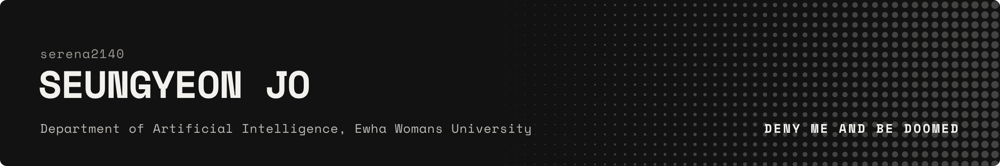
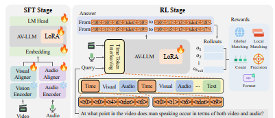
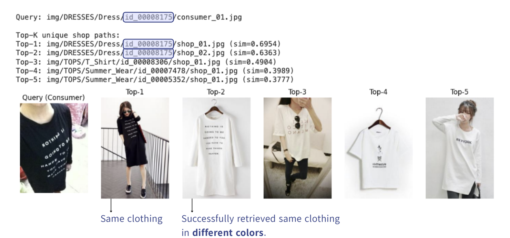
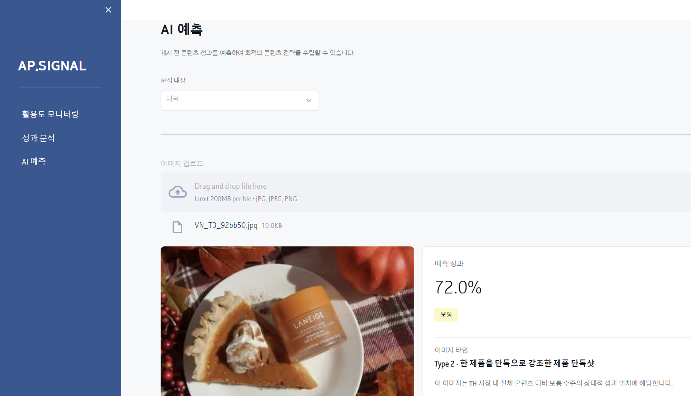
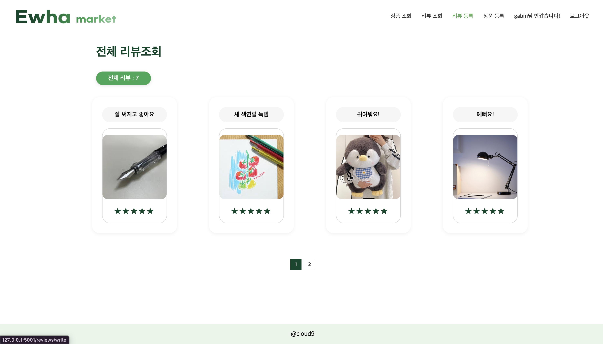
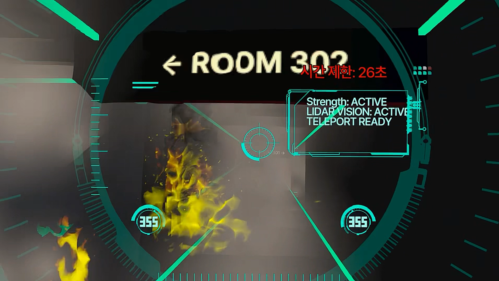

## About
- Into computer vision, automation, and figuring out systems nobody documented
- Now shipping the code and poster for TiTok (ACCV 2026)

## Projects

### [TiTok](https://github.com/AI-Living-Lab/TiTok)
ACCV 2026 · Co-author · AI-Living-Lab · [arXiv](https://arxiv.org/abs/2610.09408)

An audio-visual LLM that finds every moment an event happens in a video, not just the first one.
Models tend to miscount recurring events, so we wove time tokens into the video and audio stream and trained with RL rewards that score how many segments it finds and where.

<table>
<tr>
<td width="50%" valign="top">

### [Consumer-to-Shop Retrieval](https://github.com/2025ComputerVision/Consumer-to-Shop-Clothing-Retrieval-Using-Deep-Learning)
Computer Vision · 2025 Fall · Team of 4

Snap a photo of an outfit, find the same item in the shop. Metric learning on DeepFashion: compared backbones, losses, and preprocessing. EfficientNet-B3 + Batch-Hard Triplet Loss reached Recall@1 0.640 (R@5 0.728, R@10 0.775).

</td>
<td width="50%" valign="top">

### [AP.SIGNAL](https://github.com/EWHA-RYSH/AP.SIGNAL)
Amorepacific AI Innovation Challenge 2026 · Team lead

Upload a marketing image, get its predicted performance before it is posted. An EfficientNet-B0 multi-task model trained on Laneige Instagram data from 7 countries, running as a live [Streamlit app](https://ap-signal-2026.streamlit.app).

</td>
</tr>
<tr>
<td width="50%" valign="top">

### [EwhaMarket](https://github.com/Cloud9999999999/EwhaMarket)
Open Source SW Platform · 2025 Fall · Team of 5

A secondhand market for Ewha students only. Flask + Firebase: sign-up, listings with sorting and paging, favorites, and photo reviews with star ratings. I built the review system.

</td>
<td width="50%" valign="top">

### [Team_9radu](https://github.com/hannah0125/Team_9radu)
VR course · 2026 · Team of 4

A VR training sim for a future firefighter that puts what prototype rescue gear can do side by side with where the human body hits its limit. Unity + Meta Quest 3. I built Scenes 1–4.

</td>
</tr>
</table>

### Other projects
- [Global Workforce Modeling for South Korea](https://github.com/serena2140/Global-Workforce-Modeling-for-South-Korea) · cross-country employment modeling with XGBoost and policy proposals for Korea

---
